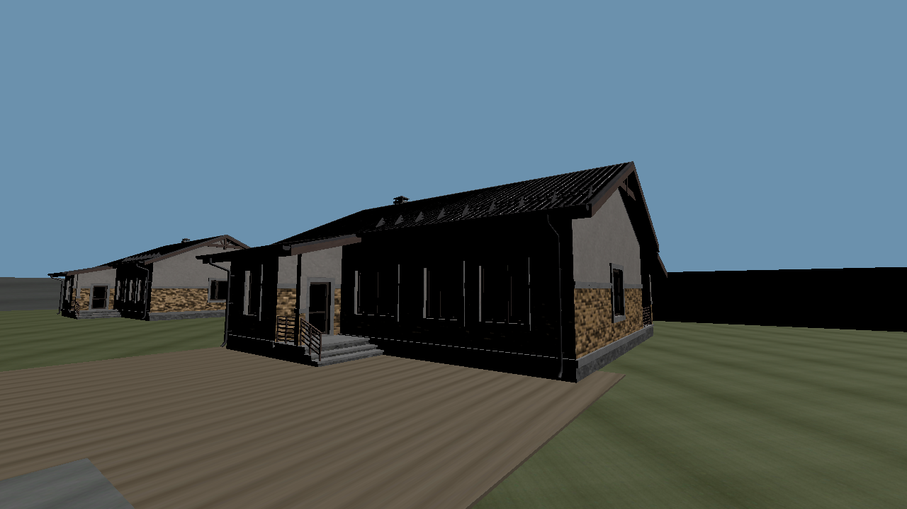
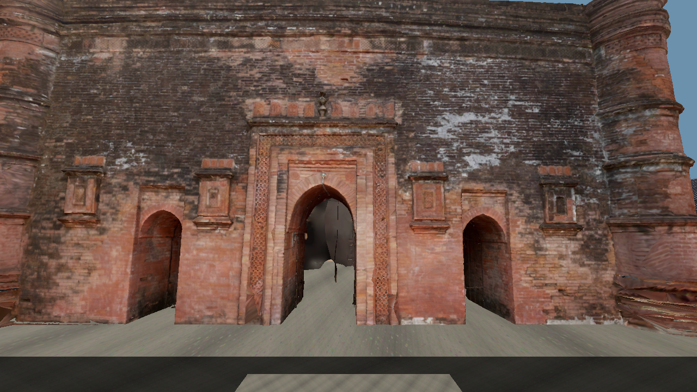
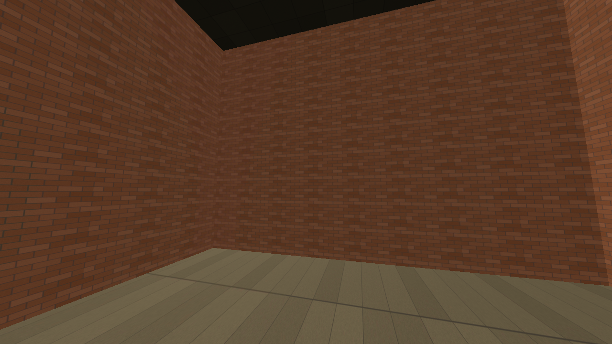
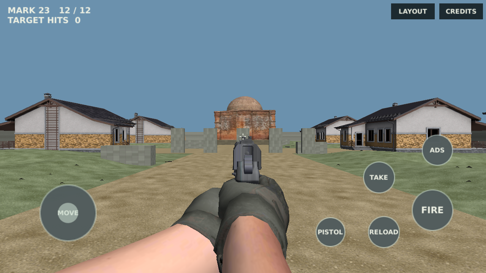
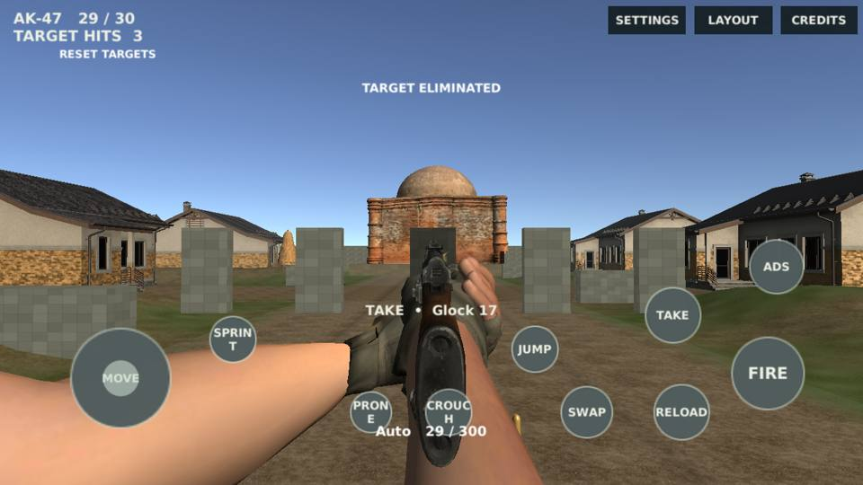
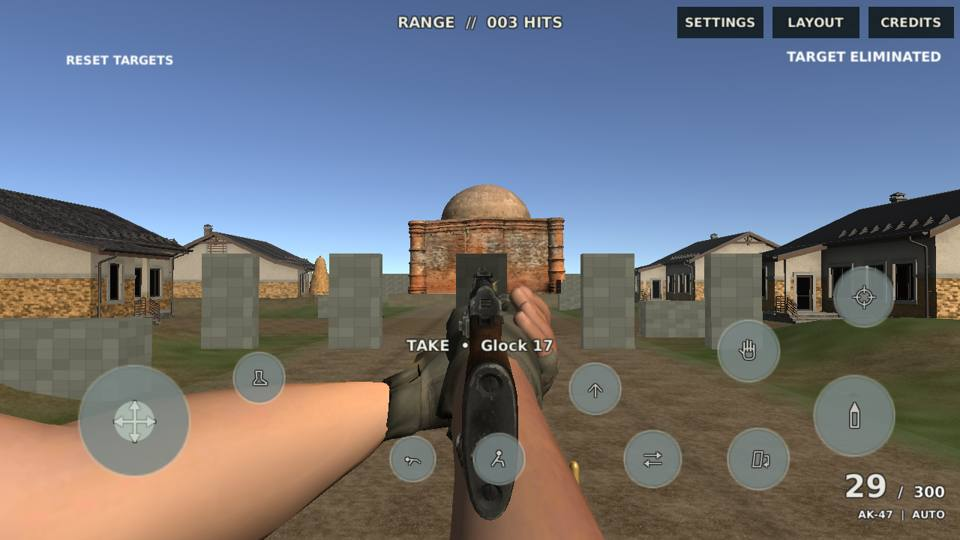
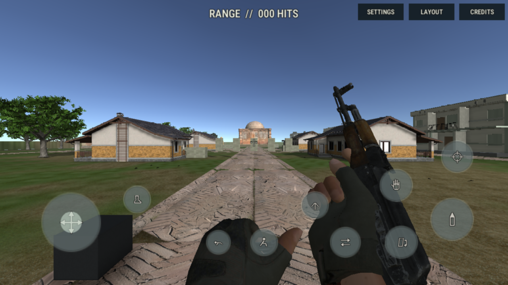
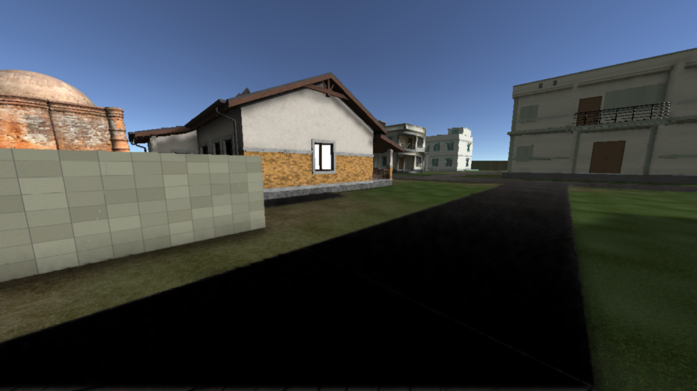
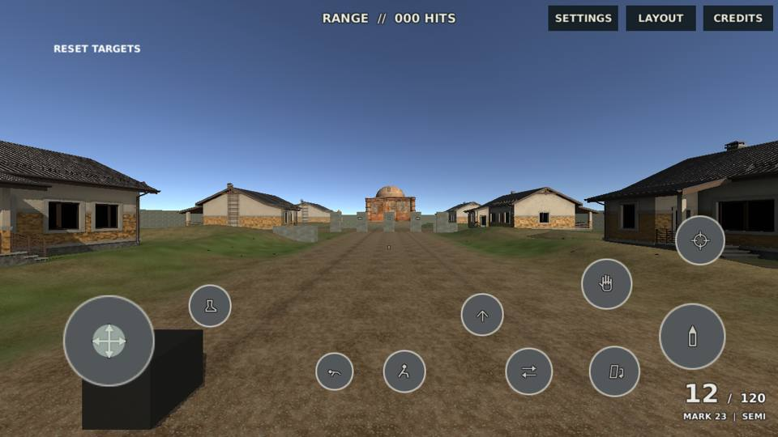

# Before / after — UI/audio foundation checkpoint, NOT final graphics acceptance

Before: verified build47, preview commit31ca449 (AK burst recovery30e0e4c). After: build51, preview commitc7d404f / genuine Play Mode recoverya2ca61d. Fixed Editor review cameras and corresponding scripted Play Mode states are retained. The world-lighting/material pass has **not** been implemented: unchanged environment rows are intentional, not evidence of a graphics upgrade. Scene/pose source captures are1280×720; recovered JPEGs are960×540 compressed derivatives, not1920×1080 acceptance or pixel-diff proof.

| Matched camera/state | Before | After UI foundation |
|---|---|---|
| Street |  |  |
| Dome / entry |  |  |
| Interior |  |  |
| Pistol ADS |  |  |
| AK burst |  |  |
| Reload midpoint |  |  |
| Terrain detail |  |  |
| Dusk preset (eighth required view) | Not captured / no dusk preset in baseline | **OPEN — not fabricated** |

## Actual pressed touch frame

Captured by the actual Play Mode pointer-state test, not an illustration. Contextual mount is hidden when unavailable; this is not an all-actions-available or physical notched-device screenshot. Pointer-down/up alpha.70/.38, eleven icon instances, actual LAYOUT drag and default profile safe bounds pass. Build50 human screenshot review found a clipped counter; build51 fixes it and adds a counter-bounds assertion. Dark glyph/text edges are visible, but no WCAG contrast metric is claimed.

## Remaining acceptance

This is seven camera/state comparisons plus an explicitly missing dusk slot, not a completed eight-view final gallery. Full lighting/shadow/SSAO, PBR/distance tiling/seam proof, material VFX/decal captures, gripping reload contacts, post-process pixel diff, mixed-output loudness/stems/spectra, and device profile gates remain OPEN in [ACCEPTANCE.md](ACCEPTANCE.md). Synth audio routing is tested; no image proves audible output or LUFS. FINAL_REPORT.md remains absent.
